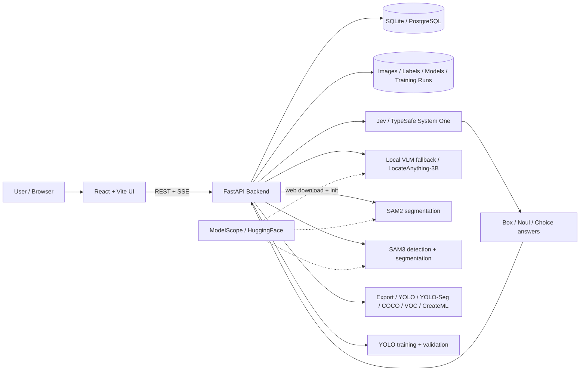

# Jev-AutoYOLO

[简体中文](README_ZH.md) | English

<p align="center">
  
  
  
  
  
</p>

```
🖼️ image/video → 🔍 Jev / SAM3 detection → 🎯 SAM2/SAM3 mask → ✏️ refine → 📦 export → 🚀 YOLO → ✅ model
```

**Images or videos in → YOLO model out**, with Jev (TypeSafe System One) auto-labeling, an optional local LocateAnything-3B fallback, SAM2.1 / SAM3 mask refinement, and human-in-the-loop correction. Multi-format export, one-click YOLO training (detect & segment), video keyframe extraction, and model validation — all GPU-accelerated on macOS MPS and Windows/Linux CUDA.



> See [Architecture & Workflow Documentation](docs/architecture_diagram_en.md) for detailed diagrams.

## Key Features
- 🤖 **Jev auto-labeling**: Open-vocabulary grounding through the hosted TypeSafe System One API, with an optional local LocateAnything-3B fallback
- 🎯 **SAM2 / SAM3 segmentation**: Bbox → pixel-precise mask with SAM 2.1 or SAM3 text-driven detection+segmentation in one pass, BBox/Mask toggle on canvas
- 🎥 **Video annotation**: Intelligent keyframe extraction (scene / motion / interval), SSIM dedup
- ✏️ **Manual refinement**: Canvas draw mode, NMS filtering, hide/show individual boxes
- 📦 **Multi-format export/import**: YOLO, YOLO-Seg, COCO JSON, Pascal VOC XML, CreateML JSON — export all saved detections or selected records as ZIP, import datasets via chunked upload (max 10GB, resume support)
- 🚀 **Training queue**: Sequential job processing with cancel support, one-click training (YOLOv8 / v11 / v26) with real-time SSE progress
- ✅ **Model validation**: Batch image / video testing, MJPEG live stream, SSE video inference
- 💾 **Smart model management**: Lazy loading, idle auto-unload, MPS/CUDA strategy pattern cleanup
- 🌐 **i18n**: English / 简体中文 / 日本語 · 🎨 **Theme**: Light / dark mode

## Documentation

📚 **[User Guide (English)](docs/guide/en/README.md)** | 📚 **[用户指南 (中文)](docs/guide/README.md)**

Comprehensive guides: quick start, annotation best practices, training parameter tuning, model deployment.

### Production Deployment (no Docker)

Use the bundled deployment helper to install dependencies, build the frontend, initialize the database, and serve the UI and API from one port.

```bash
# One-time setup (dependencies, migrations, frontend build)
./deploy.sh setup

# Start / stop / restart / status / logs
./deploy.sh start
./deploy.sh status
./deploy.sh restart
./deploy.sh stop
./deploy.sh logs
```

Access the UI at `http://<host>:8000` and API docs at `http://<host>:8000/docs`.

Runtime files:

- `deploy.log` — backend log
- `.deploy.pid` — running backend PID
- `backend/autolabeling.db` — default SQLite database
- `backend/modelscope_models/` — web-downloaded model cache

For development mode with Vite hot reload, use `./start.sh` or `python3 cli.py start`. An optional `docker-compose.yml` is kept for users who prefer containers; it is not the default deployment path.

### Manual Setup

**Requirements:**

| Resource | Minimum | Recommended |
|----------|---------|-------------|
| Python | 3.12+ | 3.12+ |
| Node.js | 22+ | 22+ |
| PostgreSQL | 16+ | 16+ |
| ffmpeg | Any | — |
| macOS | Apple Silicon 16GB | 24GB+ |
| NVIDIA GPU | Optional; 12GB VRAM for accelerated SAM2/SAM3/local VLM | 16GB+ |
| AMD ROCm GPU | Optional; ROCm 6.x/7.x + ROCm PyTorch build | — |

**Setup:**

```bash
git clone <your-repository-url>
cd Jev-AutoYOLO

# Backend
cd backend
python3 -m venv .venv
source .venv/bin/activate  # Windows: .venv\Scripts\activate
pip install -r requirements.txt
cd ..

# Frontend
cd frontend
pnpm install
cd ..

# Database (PostgreSQL recommended, but SQLite is supported out of the box)
# If using PostgreSQL:
# psql -d postgres -c "CREATE DATABASE autolabeling;"
# cp backend/.env.example backend/.env
# If you prefer a zero-setup SQLite database, just skip the two steps above. The system will auto-generate autolabeling.db

# Migrations
cd backend
PYTHONPATH=. alembic upgrade head
```

**Pre-download models (optional):**

```bash
huggingface-cli download nvidia/LocateAnything-3B --local-dir backend/model
python -c "from sam2.build_sam import build_sam2_hf; build_sam2_hf('facebook/sam2.1-hiera-base-plus', device='cpu')"
```

**Launch:**

```bash
./start.sh   # macOS / Linux
start.bat    # Windows
```

| Service | URL |
|---------|-----|
| Frontend | http://localhost:5173 |
| Backend | http://localhost:8000 |
| API Docs | http://localhost:8000/docs |

## Project Structure

Full directory tree: **[docs/STRUCTURE.md](docs/STRUCTURE.md)**

## Jev Configuration

Jev is TypeSafe's hosted System One model. It answers `Box`, `Noul`, and `Choice` questions about an image and returns normalized coordinates, so the VLM no longer needs a local GPU.

```bash
# backend/.env — direct TypeSafe API
JEV_PROVIDER=typesafe
TYPESAFE_API_KEY=your_key_here
TYPESAFE_JEV_MODEL=jev-1.14.0  # optional; this is the default
JEV_MULTI_INSTANCE=auto      # auto | single | sam3
JEV_FALLBACK_TO_LOCAL=true

# No-GPU / annotation-only deployment
DEVICE=cpu
ANNOTATION_ONLY=true

# backend/.env — via OpenRouter
JEV_PROVIDER=openrouter
OPENROUTER_API_KEY=your_openrouter_key
OPENROUTER_JEV_MODEL=~typesafe/jev-latest
```

`JEV_MODEL` is a shared fallback; `TYPESAFE_JEV_MODEL` and `OPENROUTER_JEV_MODEL` override the model name per provider, so you can switch channels without editing the other provider's model.

Get a TypeSafe key from https://console.typesafe.ai/ or use an OpenRouter key from https://openrouter.ai/. With OpenRouter, the backend calls `POST /api/alpha/decisions` because Jev is a decisions model, not a chat model. Read the API docs at https://docs.typesafe.ai/. Images and Box questions require the `TypeSafe-Danger-Zone-Images: true` header, which the backend sends automatically. Keep both API keys on the backend; they are never sent to the browser.

- `auto` detects one box per category first, then tiles the image when Jev reports `several` instances.
- `single` asks for one box per category and never tiles.
- `sam3` hands multi-instance cases to the existing SAM3 service.
- If Jev is unavailable and `JEV_FALLBACK_TO_LOCAL=true`, the backend uses the local LocateAnything-3B model when `backend/model/config.json` exists.
- Jev accepts PNG/JPEG images with each side between 280 and 1568 px. The backend resizes and pads images to fit, then maps boxes back to the original pixels.
- Optional advanced settings in the Jev tab let you append `state` (JSON, merged into the request or placed in `context`), extra global `instructions`, and per-category instructions (e.g. one instruction for `cat`, another for `dog`). Reference extra state keys in instructions with backticks, e.g. `scene`.
- `ANNOTATION_ONLY=true` hides training in the UI and does not register training routes. Annotation, YOLO validation, Jev/local-VLM/SAM detection, manual correction, history, and multi-format export remain available.
- The local LocateAnything-3B, SAM2, SAM3, and YOLO validation all support CPU (`DEVICE=cpu`), but are much slower than Jev. Switch CPU/GPU at runtime from the sidebar; switching unloads local models so the next run uses the new device.
- AMD ROCm is supported. PyTorch exposes ROCm GPUs as `cuda`, so choose `GPU (ROCm)` in the device selector. Install the ROCm build explicitly, for example `pip install torch torchvision --index-url https://download.pytorch.org/whl/rocm7.2`. `cli.py setup` auto-detects `/opt/rocm` and uses the matching ROCm wheel index.

## Features

### Jev Pre-annotation

Upload images or video keyframes with open-vocabulary descriptions (e.g. `fire, smoke`, `red car`). Jev returns normalized Box answers that are converted to pixel bounding boxes. If `TYPESAFE_API_KEY` is missing or the API is unreachable, the backend falls back to the local LocateAnything-3B model when it is installed.

- Open-vocabulary natural language descriptions
- Automatic resize/pad into Jev's 280–1568px range
- Batch upload folders or video keyframes, streaming results

### Web Model Download

The sidebar can pull and initialize local models from ModelScope without the CLI:

- VLM: `VLM_MODELSCOPE_ID` (optional; falls back to HuggingFace when no ModelScope mirror is configured)
- SAM2: `SAM2_MODELSCOPE_ID=facebook/sam2.1-hiera-base-plus`
- SAM3: `SAM3_MODELSCOPE_ID=facebook/sam3`

Use the **Pull & init** button on the model cards (including the VLM tab and SAM3 status card). Downloads run in the background and byte-level progress appears in the model status SSE stream. Paths are persisted under `backend/modelscope_models/` so they survive restarts.

**Environment split:** LocateAnything-3B needs `transformers==4.57.1`, while SAM3 needs `transformers>=5`. Keep the main backend venv on 4.57.1 and install SAM3 in its own environment:

```bash
python -m venv backend/sam3-venv
backend/sam3-venv/bin/pip install -r backend/requirements-sam3.txt
```

The web SAM3 init automatically uses `backend/sam3-venv` when it exists. HuggingFace cache paths honor `HF_HUB_CACHE`, then `HF_HOME/hub`, then `~/.cache/huggingface/hub`. `HF_TOKEN` must be exported in the process environment; values only in `backend/.env` are not visible to Transformers/HuggingFace. ModelScope-cached VLM/SAM2/SAM3 models are detected and reused by both the web UI and CLI.

Cached models are reused: if the expected weights are already present, **Pull & init** skips the download and only loads the model. Only one model download/initialization runs at a time, and redundant ModelScope files (for example `model.safetensors` when SAM2 uses its `.pt` checkpoint) are cleaned up.

### SAM2 Segmentation

Enable SAM2 (Segment Anything Model 2) to refine Jev bounding boxes into pixel-precise masks.

- Check "Enable SAM2 Segmentation" before detection — runs automatically after Jev
- SAM 2.1 model (base+), lazy-loaded with idle auto-unload
- Score threshold slider for mask quality filtering
- Masks rendered as semi-transparent overlays on canvas
- BBox and Mask independently toggled on both main canvas and hover preview
- Result table shows polygon vertex count per box

### SAM3 Detection + Segmentation

Switch to SAM3 mode for text-driven detection and segmentation in a single pass — no Jev request required.

- Toggle between Jev, local VLM (LocateAnything), and SAM3 via the model selector; enable SAM2 separately for mask refinement
- Enter open-vocabulary text prompts (e.g. `cat`, `red car`) — SAM3 detects and segments all matching instances
- **Confidence threshold** slider (0.0–1.0, default 0.5) controls detection sensitivity
- **Mask threshold** slider (0.0–1.0, default 0.5) controls mask tightness
- Enable/disable segmentation independently — bbox-only mode skips mask extraction for faster results
- SAM3 runs as a standalone HTTP service on port 8002 with its own venv (`backend/sam3-venv/`)
- **Requires `HF_TOKEN`** — set this env var before starting the backend. Two steps:
  1. Open [huggingface.co/facebook/sam3](https://huggingface.co/facebook/sam3) in browser, click **"Agree and access repository"**
  2. Create a **Read** token at [huggingface.co/settings/tokens](https://huggingface.co/settings/tokens) (no need for Fine-grained — a plain Read token inherits your account's permissions)
  Model cached in `~/.cache/huggingface/hub/` after first download
- Auto-starts on first use, idle auto-unload after 10 min
- Real-time loading status via SSE (`starting` → `loading` → `loaded`)
- Manual unload button to free GPU memory
- Backend auto-switches: using SAM3 releases the local fallback/SAM2; Jev is a remote API and needs no unloading
- Detection records tagged with `model_type` (`jev` / `jev+sam2` / `jev+sam3`; legacy `vlm` records remain readable)

### Video Annotation

Upload a video, extract keyframes, select and batch-annotate.

- **Three extraction modes**: scene change, motion detection (optical flow), fixed interval
- **SSIM deduplication**: auto-removes near-duplicate frames
- **Timeline preview**: horizontal scrollable strip, click for full-size view
- **Multi-select**: check frames, select/cancel all, load to annotation queue

### Manual Annotation

Canvas-based annotation with View / Draw modes.

- Category quick-fill from history
- Jev pre-annotation baseline → delete mistakes → draw missing boxes
- All / Best / NMS filter modes, settings saved per detection
- Hide individual boxes while inspecting dense results
- Per-frame re-detection

### History Management

- Thumbnail + category tag previews, tag-based multi-select filtering
- Click to view details, re-detect with updated labels, virtual scroll with infinite loading
- Single / batch / full-history export in **5 formats**: YOLO, YOLO-Seg, COCO JSON, Pascal VOC XML, CreateML JSON
- Format selection via dropdown menu, one-click zip download

### YOLO Training

- **Series**: YOLOv8 / v11 / v26 (n/s/m/l/x)
- **Task types**: Object Detection (Detect), Instance Segmentation (Segment)
- Segmentation training auto-uses SAM2 polygon labels; falls back to bbox when unavailable
- Tag filter + thumbnail preview for precise data selection
- Virtual scroll with "Load All" button for large datasets
- Dataset split presets (70/20/10, 80/20, 90/10, 60/20/20)
- Real-time SSE progress: Epoch / Loss / mAP50
- Rename training jobs for easier identification
- Auto ONNX export; download PT / ONNX / dataset zip

### Model Validation

- **Dual source**: trained models or externally uploaded `.pt` files
- **Conf / IoU sliders** for real-time threshold tuning
- **Batch image validation** with bounding boxes and confidence scores
- **Video validation** (three modes):
  - MJPEG live stream with interactive play/pause
  - SSE prediction stream with per-frame JSON events
  - Sync batch prediction — all frames at once
- Temporary results; export predictions as YOLO `.txt` files

### Model Management

- **Lazy loading**: the local fallback, SAM2, and SAM3 load on first use and unload after idle (default 10 min). Jev is a remote API.
- **Idle watchdog**: all three models auto-unload after `MODEL_IDLE_TIMEOUT_SECONDS` of inactivity
- **Unified SSE status**: `GET /api/v1/model/events` streams Jev, local fallback, SAM2, and SAM3 status in one connection
- **Manual unload**: each model has its own unload button and API endpoint
- **GPU memory**: Strategy Pattern (`gpu_memory.py`) — CUDA `expandable_segments` / MPS `synchronize`+`empty_cache`+`gc`
- **Transparent load errors**: model load/inference failures are returned to the UI instead of being hidden behind generic detection errors

### Troubleshooting: Stuck at `Loading to GPU`

If the local fallback stays at `Loading to GPU`, the model files were already found and the failure is likely happening while PyTorch moves LocateAnything-3B onto CUDA/MPS. Check the toast or backend logs for CUDA OOM, missing NVIDIA runtime, driver mismatch, or a dependency import error. For Jev errors, check `TYPESAFE_API_KEY`, network access, and the backend log line that includes the TypeSafe error detail.

Native checks:

```bash
tail -n 200 deploy.log
backend/.venv/bin/python - <<'PY'
import torch
print("torch:", torch.__version__, "hip:", torch.version.hip)
print("cuda/rocm available:", torch.cuda.is_available())
print("device:", torch.cuda.get_device_name(0) if torch.cuda.is_available() else None)
PY
rocm-smi    # AMD ROCm
nvidia-smi  # NVIDIA CUDA
```

## API Reference

Full API documentation with request/response examples: **[docs/API.md](docs/API.md)**

## Cross-Platform

| Platform | Inference | Training |
|----------|-----------|----------|
| macOS (Apple Silicon) | MPS | MPS |
| Linux / Windows (NVIDIA) | CUDA | CUDA |
| Linux (AMD ROCm) | ROCm via PyTorch `cuda` | ROCm via PyTorch `cuda` |
| CPU | Local VLM / SAM2 / SAM3 / YOLO | CPU (slow) |

Auto-detection: CUDA/ROCm → MPS → CPU. Override at runtime from the sidebar or via `DEVICE` env.

## Highlights

- **MPS / CUDA full-pipeline GPU acceleration** — local fallback, SAM2, and YOLO training are GPU-accelerated; Jev runs remotely
- **Strategy Pattern GPU memory** — `gpu_memory.py` centralizes CUDA / MPS cleanup; `expandable_segments:True`
- **SAM2 / SAM3 mask refinement** — SAM2 refines Jev bboxes; SAM3 does text-driven detection+segmentation in one pass
- **5 export formats** — YOLO, YOLO-Seg, COCO, Pascal VOC, CreateML; export selected records or the full detection history
- **Detect & Segment training** — polygon labels auto-used when SAM2 masks are available
- **Cross-platform** — macOS MPS, Windows / Linux CUDA, unified codebase
- **Unified SSE model status** — single EventSource for Jev, local fallback, SAM2, and SAM3 states; no polling

## Development

```bash
# Frontend
cd frontend && pnpm install && pnpm run lint && pnpm run build

# Backend
cd backend && source .venv/bin/activate
PYTHONPATH=. alembic upgrade head
python -m compileall app alembic
```

## Acknowledgements

This project is derived from and builds on [VLM-AutoYOLO](https://github.com/Somnusochi/VLM-AutoYOLO). Thanks to the original author and contributors.

## License

Code: [AGPL-3.0](LICENSE).

Third-party dependencies:
- Jev / TypeSafe System One — hosted API, subject to the [TypeSafe terms](https://docs.typesafe.ai/legal.md)
- LocateAnything-3B model — [NVIDIA License](https://huggingface.co/nvidia/LocateAnything-3B/blob/main/LICENSE) (non-commercial use only)
- SAM3 model — [Facebook Research License](https://huggingface.co/facebook/sam3) (gated repository, requires HuggingFace access token)
- Ultralytics YOLO — [AGPL-3.0](https://github.com/ultralytics/ultralytics/blob/main/LICENSE) (copyleft; training/deployment may trigger obligations)
