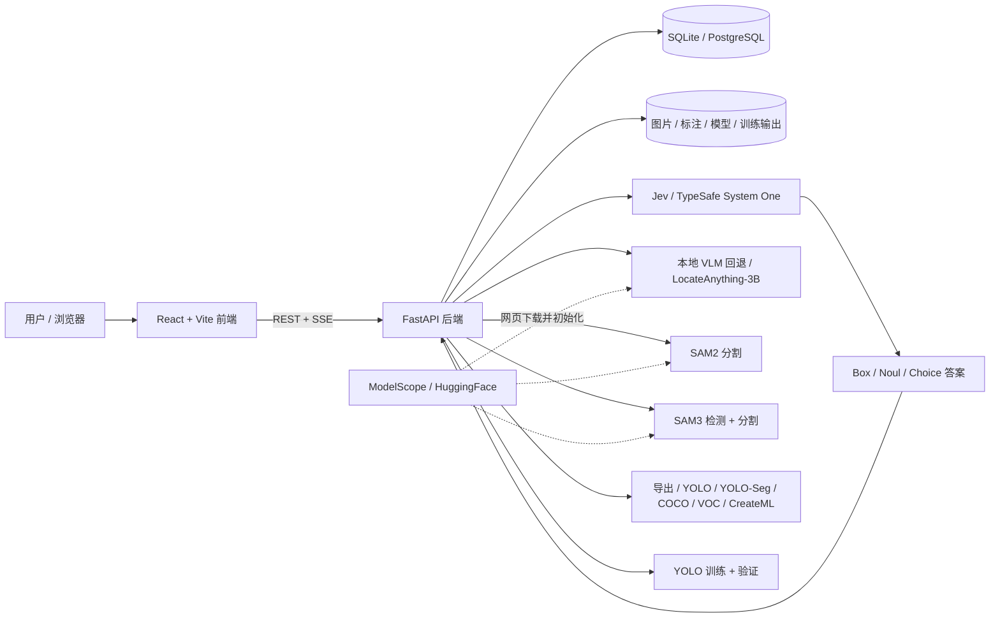

# Jev-AutoYOLO

[English](README.md) | 简体中文

<p align="center">
  
  
  
  
  
</p>

```
🖼️ 图片/视频 → 🔍 Jev / SAM3 检测 → 🎯 SAM2/SAM3 分割 → ✏️ 修正 → 📦 导出 → 🚀 YOLO → ✅ 模型
```

**图片/视频扔进去 → YOLO 模型训出来**，基于 Jev（TypeSafe System One）的自动标注 + 可选本地 LocateAnything-3B 回退 + SAM2.1 / SAM3 mask 精修 + 人工闭环修正。多格式数据集导入导出、训练任务队列、一键 YOLO 训练（检测 & 分割）、视频关键帧提取、模型验证——macOS MPS / Windows & Linux CUDA 全链路 GPU 加速。



> 详细流程图请查看 [架构与流程文档](docs/architecture_diagram.md)。

## 核心功能
- 🤖 **Jev 自动标注**：通过托管的 TypeSafe System One API 做开放词汇定位，可选本地 LocateAnything-3B 回退
- 🎯 **SAM2 / SAM3 分割**：SAM2 精修 Jev 检测框；SAM3 文本驱动的端到端检测+分割，BBox/Mask 画布独立开关
- 🎥 **视频标注**：智能关键帧提取（场景/运动/间隔），SSIM 去重
- ✏️ **人工修正**：Canvas 画框模式，NMS 过滤，单框隐藏
- 📦 **多格式导入/导出**：YOLO、YOLO-Seg、COCO JSON、Pascal VOC XML、CreateML JSON — 支持全量或选中检测记录导出 ZIP，分片上传支持最大 10GB、断点续传
- 🚀 **训练队列**：任务排队串行执行，支持取消，一键 YOLO 训练（v8 / v11 / v26）SSE 实时进度
- ✅ **模型验证**：批量图片/视频测试，MJPEG 实时流，SSE 视频推理
- 💾 **智能模型管理**：Jev 远程 API；本地回退/SAM2/SAM3 惰性加载，闲置自动卸载，统一 SSE 状态推送，MPS/CUDA 策略模式内存回收
- 🌐 **国际化**：中文 / English / 日本語 · 🎨 **主题**：亮色/暗色模式

## 文档

📚 **[用户指南 (中文)](docs/guide/README.md)** | 📚 **[User Guide (English)](docs/guide/en/README.md)**

完整指南：快速开始、标注最佳实践、训练参数调优、模型部署。

### 生产部署（无 Docker）

使用仓库自带的部署脚本完成依赖安装、前端构建、数据库初始化，并由后端同时提供 UI 和 API（只需一个端口）。

```bash
# 首次部署（安装依赖、执行迁移、构建前端）
./deploy.sh setup

# 启动 / 停止 / 重启 / 状态 / 日志
./deploy.sh start
./deploy.sh status
./deploy.sh restart
./deploy.sh stop
./deploy.sh logs
```

访问 `http://<host>:8000`，API 文档为 `http://<host>:8000/docs`。

运行文件：

- `deploy.log` — 后端日志
- `.deploy.pid` — 后端进程 PID
- `backend/autolabeling.db` — 默认 SQLite 数据库
- `backend/modelscope_models/` — 网页下载的模型缓存

开发模式（Vite 热更新）请使用 `./start.sh` 或 `python3 cli.py start`。仓库保留可选的 `docker-compose.yml`，供偏好容器的用户使用，但不是默认部署方式。

### 手动安装

**环境要求：**

| 资源 | 最低配置 | 推荐配置 |
|------|---------|---------|
| Python | 3.12+ | 3.12+ |
| Node.js | 22+ | 22+ |
| PostgreSQL | 16+ | 16+ |
| ffmpeg | 任意版本 | — |
| macOS | Apple Silicon 16GB | 24GB+ |
| NVIDIA GPU | 可选；12GB 显存可加速 SAM2/SAM3/本地 VLM | 16GB+ |
| AMD ROCm GPU | 可选；ROCm 6.x/7.x + ROCm 版 PyTorch | — |

**安装：**

```bash
git clone <your-repository-url>
cd Jev-AutoYOLO

# 后端
cd backend
python3 -m venv .venv
source .venv/bin/activate  # Windows: .venv\Scripts\activate
pip install -r requirements.txt
cd ..

# 前端
cd frontend
pnpm install
cd ..

# 数据库 (PostgreSQL 推荐，但也支持 SQLite)
# 如果使用 PostgreSQL:
# psql -d postgres -c "CREATE DATABASE autolabeling;"
# cp backend/.env.example backend/.env
# 如果你想使用免安装的 SQLite 本地数据库，直接跳过上方两步，系统会自动生成 autolabeling.db

# 迁移
cd backend
PYTHONPATH=. alembic upgrade head
```

**预下载模型（可选）：**

```bash
huggingface-cli download nvidia/LocateAnything-3B --local-dir backend/model
python -c "from sam2.build_sam import build_sam2_hf; build_sam2_hf('facebook/sam2.1-hiera-base-plus', device='cpu')"
```

**启动：**

```bash
./start.sh   # macOS / Linux
start.bat    # Windows
```

| 服务 | 地址 |
|------|------|
| 前端 | http://localhost:5173 |
| 后端 | http://localhost:8000 |
| API 文档 | http://localhost:8000/docs |

## 项目结构

完整目录树：**[docs/STRUCTURE_ZH.md](docs/STRUCTURE_ZH.md)**

## Jev 配置

Jev 是 TypeSafe 托管的 System One 模型，通过 `Box` / `Noul` / `Choice` 问题返回结构化答案，因此 VLM 不再需要本地 GPU。

```bash
# backend/.env — 直连 TypeSafe
JEV_PROVIDER=typesafe
TYPESAFE_API_KEY=your_key_here
TYPESAFE_JEV_MODEL=jev-1.14.0  # 可选，默认值
JEV_MULTI_INSTANCE=auto      # auto | single | sam3
JEV_FALLBACK_TO_LOCAL=true

# 无 GPU / 仅标注部署
DEVICE=cpu
ANNOTATION_ONLY=true

# backend/.env — 通过 OpenRouter
JEV_PROVIDER=openrouter
OPENROUTER_API_KEY=your_openrouter_key
OPENROUTER_JEV_MODEL=~typesafe/jev-latest
```

`JEV_MODEL` 是通用回退；`TYPESAFE_JEV_MODEL` 和 `OPENROUTER_JEV_MODEL` 可按渠道覆盖模型名称，切换渠道时无需改动另一渠道的模型。

在 https://console.typesafe.ai/ 创建 TypeSafe Key，或在 https://openrouter.ai/ 创建 OpenRouter Key。使用 OpenRouter 时，后端调用 `POST /api/alpha/decisions`，因为 Jev 是 decisions 模型而不是 chat 模型。文档见 https://docs.typesafe.ai/。图片与 Box 问题需要 `TypeSafe-Danger-Zone-Images: true`，后端会自动携带。这些 Key 只保存在后端，不会下发到浏览器。

- `auto`：先每个类别问一个框，Jev 判断为 `several` 时自动分块检测。
- `single`：每个类别只返回一个框，不分块。
- `sam3`：多实例交给现有 SAM3 服务。
- Jev 不可用且 `JEV_FALLBACK_TO_LOCAL=true` 时，若 `backend/model/config.json` 存在，则回退到本地 LocateAnything-3B。
- Jev 图片每边需在 280–1568 px 之间；后端会自动缩放/补边，并把框映射回原图。
- Jev Tab 提供可选高级设置：可追加 `state`（JSON；对象会合并进请求，数组/字符串放入 `context`）、全局附加 `instructions`，以及按类别单独设置 instructions（例如 cat 一条、dog 一条）。可在 instructions 中用反引号引用附加 state 的键名，例如 `scene`。
- `ANNOTATION_ONLY=true` 只隐藏训练界面，不注册训练 API；标注、YOLO 验证、Jev/本地 VLM/SAM 检测、人工修正、历史记录和多格式导出保持可用。
- 本地 LocateAnything-3B、SAM2、SAM3 和 YOLO 验证均支持 CPU（`DEVICE=cpu`），但速度远慢于 Jev。侧边栏可运行时切换 CPU/GPU，切换时会卸载本地模型，下一次推理使用新设备。
- 支持 AMD ROCm。PyTorch 会把 ROCm GPU 暴露为 `cuda`，设备选择器会显示 `GPU (ROCm)`。请显式安装 ROCm 版 PyTorch，例如 `pip install torch torchvision --index-url https://download.pytorch.org/whl/rocm7.2`；`cli.py setup` 会检测 `/opt/rocm` 并自动使用对应索引。

## 功能


### Jev 预标注

上传图片或视频关键帧，输入开放词汇描述（如 `fire, smoke`、`红色汽车`）。Jev 返回归一化 Box 答案，后端转换为像素边界框。若未配置 `TYPESAFE_API_KEY` 或 API 不可达，且本地已安装 LocateAnything-3B，则自动回退到本地模型。

- 开放词汇自然语言描述
- 后端自动缩放到 Jev 支持的 280–1568px 范围
- 批量上传文件夹或视频关键帧，流式返回

### 网页拉取模型

侧边栏可以直接从 ModelScope 拉取并初始化本地模型，无需 CLI：

- VLM：`VLM_MODELSCOPE_ID`（可选；未配置 ModelScope 镜像时回退 HuggingFace）
- SAM2：`SAM2_MODELSCOPE_ID=facebook/sam2.1-hiera-base-plus`
- SAM3：`SAM3_MODELSCOPE_ID=facebook/sam3`

在模型卡片上点击「拉取并初始化」（VLM Tab、SAM2、SAM3 状态卡片均可）。下载在后台执行，按字节计算的进度通过模型状态 SSE 推送；路径保存在 `backend/modelscope_models/`，重启后自动恢复。

**环境隔离：** LocateAnything-3B 需要 `transformers==4.57.1`，而 SAM3 需要 `transformers>=5`。主后端 venv 保持 4.57.1，SAM3 安装到独立环境：

```bash
python -m venv backend/sam3-venv
backend/sam3-venv/bin/pip install -r backend/requirements-sam3.txt
```

网页端初始化 SAM3 时会自动使用 `backend/sam3-venv`。HuggingFace 缓存路径按 `HF_HUB_CACHE` → `HF_HOME/hub` → `~/.cache/huggingface/hub` 解析。`HF_TOKEN` 必须导出到进程环境，只写在 `backend/.env` 中对 Transformers/HuggingFace 不可见。网页端和 CLI 都会识别并复用 ModelScope 已下载的 VLM/SAM2/SAM3 模型。

已下载的模型会被复用：如果权重文件完整，「拉取并初始化」会跳过下载直接加载。同一时间只允许一个模型下载/初始化任务，并会自动清理 ModelScope 中多余的重复文件（例如 SAM2 已有 `.pt` 时不再保留 `model.safetensors`）。

### SAM2 分割

Jev 检测出 bbox 后，可启用 SAM2 自动生成像素级 mask 轮廓。

- 勾选「启用 SAM2 分割」后自动运行
- SAM 2.1 模型（base+），惰性加载，闲置自动卸载
- 评分阈值滑块控制 mask 质量过滤
- mask 半透明叠加在画布上，bbox 和 mask 独立开关
- 结果表格显示每个目标的 mask 顶点数，预览浮窗同步渲染

### SAM3 检测 + 分割

切换到 SAM3 模式实现文本驱动的端到端检测与分割——无需 Jev 请求。

- 通过侧边栏模型选择器在 Jev、本地 VLM（LocateAnything）和 SAM3 之间切换；SAM2 精修单独勾选
- 输入开放词汇文本提示（如 `猫`、`红色汽车`），SAM3 自动检测并分割所有匹配实例
- **置信度阈值**滑块（0.0–1.0，默认 0.5）控制检测灵敏度
- **Mask 阈值**滑块（0.0–1.0，默认 0.5）控制 mask 紧致度
- 可独立开关分割：纯检测模式跳过 mask 提取，更快出结果
- SAM3 作为独立 HTTP 服务运行在 8002 端口，使用独立虚拟环境（`backend/sam3-venv/`）
- **需要 `HF_TOKEN` 环境变量**——启动后端前设置，分两步：
  1. 浏览器打开 [huggingface.co/facebook/sam3](https://huggingface.co/facebook/sam3)，点击 **"Agree and access repository"** 同意协议
  2. 在 [huggingface.co/settings/tokens](https://huggingface.co/settings/tokens) 创建一个 **Read** 类型 Token（无需 Fine-grained，普通 Read Token 自动继承账号权限）
  首次下载后模型缓存在 `~/.cache/huggingface/hub/`
- 首次使用时自动启动，闲置 10 分钟后自动卸载
- SSE 实时加载状态（`starting` → `loading` → `loaded`）
- 手动卸载按钮释放 GPU 内存
- 后端自动互斥：使用 SAM3 时释放本地回退/SAM2；Jev 是远程 API，无需卸载
- 检测记录标注模型类型（`jev` / `jev+sam2` / `jev+sam3`；旧 `vlm` 记录仍可读取）

### 视频标注

上传视频，智能提取关键帧，挑选后批量标注。

- **三种提取方式**：场景切换、运动检测（光流法）、固定间隔
- **SSIM 去重**：自动去除相似帧
- **时间轴预览**：水平滑动浏览，点击放大
- **多选机制**：勾选帧、全选/取消全选、加载到标注队列

### 手动标注

Canvas 画框模式，查看/标注双模式切换。

- 历史类别快速填充
- Jev 预标注打底 → 删错框 → 补漏框
- 全部 / 最优 / NMS 去重过滤，设置可保存
- 临时隐藏单框，密集检测结果检查
- 单帧重新检测

### 历史管理

- 缩略图 + 类别标签，按标签多选筛选
- 点击查看详情，支持重新检测，虚拟滚动 + 无限加载
- 单张/批量/全量历史导出 **5 种格式**：YOLO、YOLO-Seg、COCO JSON、Pascal VOC XML、CreateML JSON
- 下拉菜单选格式，一键下载 zip

### YOLO 训练

- **系列**：YOLOv8 / v11 / v26（n/s/m/l/x）
- **任务类型**：目标检测（Detect）、实例分割（Segment）
- 分割训练自动使用 SAM2 polygon 标签，无 polygon 时 fallback 到 bbox
- 标签筛选 + 缩略图预览精确选择训练数据
- 虚拟滚动 + 「加载全部」按钮，大数据集无卡顿
- 训练任务支持重命名，便于辨识
- 数据集拆分预设（70/20/10、80/20、90/10、60/20/20）
- SSE 实时推送：Epoch / Loss / mAP50
- 自动 ONNX 导出，可下载 PT / ONNX / 数据集 zip

### 模型验证

- **双模型源**：训练模型或外部上传 `.pt` 文件
- **Conf / IoU 滑块**实时调节阈值
- **图片批量验证**，显示边界框和置信度
- **视频验证**（三种模式）：
  - MJPEG 实时流，支持交互式暂停
  - SSE 预测流，逐帧 JSON 事件
  - 同步批量预测，一次性返回全部结果
- 临时结果，可导出 YOLO `.txt` 标注

### 模型管理

- **惰性加载**：本地回退、SAM2、SAM3 首次使用自动加载，闲置超时自动卸载（默认 10 分钟）；Jev 为远程 API
- **闲置看门狗**：三个模型均有 watchdog，通过 `MODEL_IDLE_TIMEOUT_SECONDS` 配置
- **统一 SSE 状态**：`GET /api/v1/model/events` 单连接推送三模型状态，前端不再轮询
- **手动卸载**：每个模型均有独立卸载按钮和 API 端点
- **GPU 内存**：策略模式（`gpu_memory.py`）— CUDA `expandable_segments` / MPS `synchronize`+`empty_cache`+`gc`
- **透明加载错误**：模型加载/推理失败会把真实后端错误返回前端，不再只显示笼统的检测失败

### 排查：卡在 `加载到 GPU`

如果本地回退模型一直停在 `加载到 GPU`，通常说明模型文件已经被找到，问题发生在 PyTorch 将 LocateAnything-3B 搬到 CUDA/MPS 的阶段。请查看 toast 或后端日志，常见原因包括 CUDA OOM、NVIDIA runtime 未透传、驱动/runtime 不匹配，或依赖导入失败。Jev 报错时请检查 `TYPESAFE_API_KEY`、网络，以及后端日志中的 TypeSafe 错误详情。

本地环境可先检查：

```bash
tail -n 200 deploy.log
backend/.venv/bin/python - <<'PY'
import torch
print("torch:", torch.__version__, "hip:", torch.version.hip)
print("cuda/rocm available:", torch.cuda.is_available())
print("device:", torch.cuda.get_device_name(0) if torch.cuda.is_available() else None)
PY
rocm-smi    # AMD ROCm
nvidia-smi  # NVIDIA CUDA
```

## API 概览

完整 API 文档与请求/响应示例：**[docs/API_ZH.md](docs/API_ZH.md)**

## 跨平台

| 平台 | 推理后端 | 训练后端 |
|------|---------|---------|
| macOS (Apple Silicon) | MPS | MPS |
| Linux / Windows (NVIDIA) | CUDA | CUDA |
| Linux (AMD ROCm) | ROCm（PyTorch `cuda`） | ROCm（PyTorch `cuda`） |
| CPU | 本地 VLM / SAM2 / SAM3 / YOLO | CPU（较慢） |

自动检测：CUDA/ROCm → MPS → CPU。可在侧边栏运行时切换，或通过 `DEVICE` 环境变量覆盖。

## 项目亮点

- **MPS / CUDA 全链路 GPU 加速** — 本地回退推理、SAM2 分割、YOLO 训练均跑 GPU；Jev 在远端运行
- **策略模式 GPU 内存管理** — `gpu_memory.py` 统一 CUDA / MPS 清理；`expandable_segments:True`
- **SAM2 / SAM3 mask 精修** — SAM2 精修 Jev bbox；SAM3 文本驱动端到端检测+分割
- **5 种导出格式** — YOLO、YOLO-Seg、COCO、Pascal VOC、CreateML；支持选中记录或全部检测历史导出
- **检测 & 分割训练** — SAM2 polygon 标签自动用于分割训练
- **跨平台** — macOS MPS、Windows / Linux CUDA，统一代码库
- **智能模型生命周期** — 惰性加载、闲置自动卸载、后台下载带进度

## 开发与校验

```bash
# 前端
cd frontend && pnpm install && pnpm run lint && pnpm run build

# 后端
cd backend && source .venv/bin/activate
PYTHONPATH=. alembic upgrade head
python -m compileall app alembic
```

## 致谢

本项目基于 [VLM-AutoYOLO](https://github.com/Somnusochi/VLM-AutoYOLO) 发展而来，感谢原作者与贡献者。

## License

本项目代码：[AGPL-3.0](LICENSE)。

第三方依赖协议：
- Jev / TypeSafe System One — 托管 API，使用须遵守 [TypeSafe 条款](https://docs.typesafe.ai/legal.md)
- LocateAnything-3B 模型 — [NVIDIA License](https://huggingface.co/nvidia/LocateAnything-3B/blob/main/LICENSE)（非商用）
- Ultralytics YOLO — [AGPL-3.0](https://github.com/ultralytics/ultralytics/blob/main/LICENSE)（copyleft，训练/部署可能触发开源义务）
