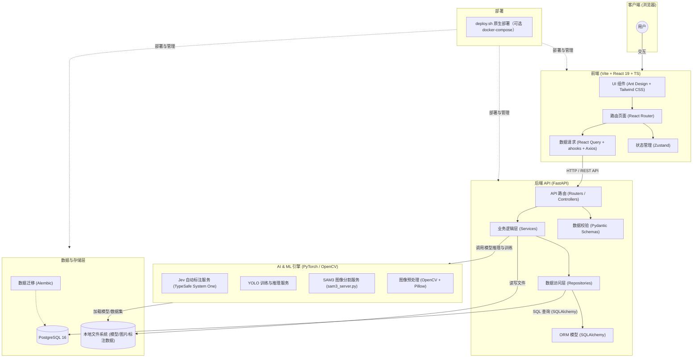
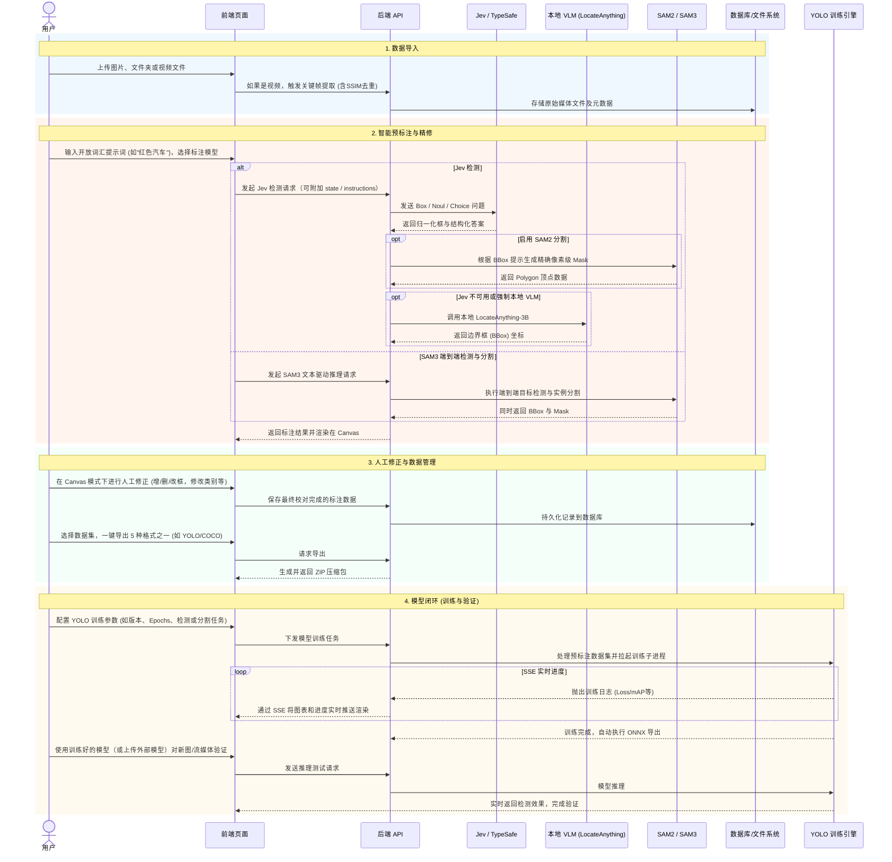

# Jev-AutoYOLO 项目架构设计图

根据对当前代码库的分析，这是一个全栈架构的 AI 平台，主要用于基于 Jev（TypeSafe System One）的自动标注、可选本地 VLM 回退以及 YOLO 模型训练。项目采用现代化的前后端分离架构，默认通过 `deploy.sh` 原生部署；仓库同时保留可选的 `docker-compose.yml`。

以下是系统的整体架构图：

## 架构说明

### 1. 前端层 (Frontend)
- **核心框架**：使用 Vite 构建的 React 19 单页应用 (SPA)。
- **样式与 UI**：采用 `Ant Design` 配合 `Tailwind CSS` 进行响应式和现代化界面开发，并配置了 `unocss` 进行样式处理。
- **状态管理**：使用轻量级的 `Zustand` 管理全局状态。
- **数据请求**：结合 `Axios`, `React Query` 和 `ahooks`（如 `useRequest`）进行高效的异步数据获取和缓存管理。
- **国际化**：支持 `react-i18next` 提供多语言支持。

### 2. 后端层 (Backend)
- **核心框架**：基于 `FastAPI` 构建的高性能异步 RESTful API。
- **架构模式**：采用经典的分层架构：
  - **Routers/API**: 处理 HTTP 请求和路由分发。
  - **Schemas**: 使用 `Pydantic` 进行请求和响应的数据校验。
  - **Services**: 封装核心业务逻辑。
  - **Repositories**: 抽象数据库访问逻辑，解耦业务与数据层。
  - **Models**: `SQLAlchemy` ORM 模型定义。

### 3. AI & ML 引擎 (AI Engine)
- 此层主要与机器学习相关，是自动标注和模型训练的核心：
  - **Jev 自动标注**：通过 TypeSafe System One（或 OpenRouter Decisions）执行 Box / Noul / Choice 判断；可选回退到本地 LocateAnything-3B。
  - **SAM2 / SAM3 分割**：SAM2 根据 BBox 生成 mask；SAM3 通过独立 `sam3_server.py` 完成文本驱动的检测与分割。
  - **YOLO 训练与验证**：集成目标检测/分割训练流程，并支持训练模型验证。
  - **模型下载**：可从网页通过 ModelScope（或 HuggingFace）拉取 VLM / SAM2 / SAM3 并初始化，支持字节级下载进度、缓存复用和单任务互斥。
  - 依赖 `PyTorch` (`torch`) 和 `OpenCV` 进行张量计算与图像处理；支持 CPU、CUDA、MPS 和 AMD ROCm。

### 4. 数据与存储层 (Storage)
- **关系型数据库**：使用 `PostgreSQL 16` 存储结构化数据（如任务、用户配置、标注元数据等）。
- **数据库迁移**：使用 `Alembic` 管理数据库 schema 的版本迭代。
- **文件存储**：本地挂载的 Volume（如 `model-cache`, `uploads`, `training_runs`）用于存储权重文件、上传的图片和训练输出。

### 5. 部署 (Deployment)
- 默认使用根目录的 `deploy.sh` 完成依赖安装、前端构建、数据库迁移和服务启动，后端同时提供构建后的前端页面。
- `docker-compose.yml` 作为可选容器化方案保留，不作为默认部署路径。

## 核心业务流程 (Workflow)

整个平台的业务流程设计紧扣“数据输入 -> AI 预处理 -> 人工校对 -> 模型产出”的飞轮机制，具体交互流程如下：

