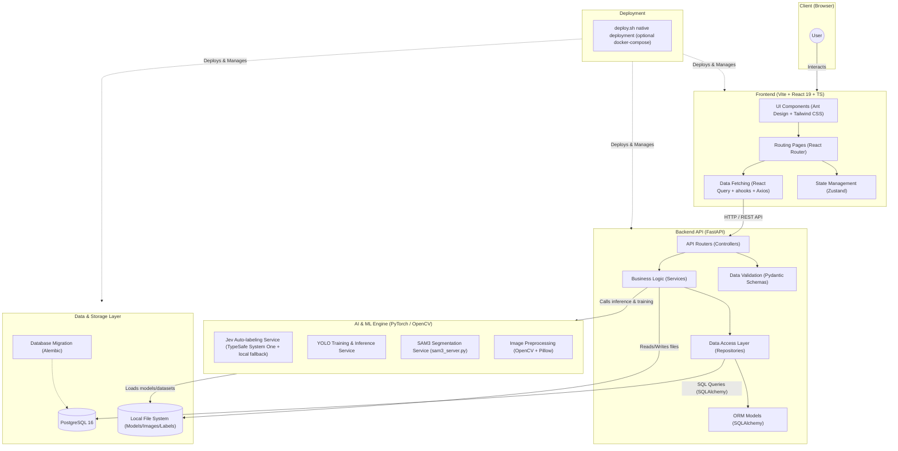

# Jev-AutoYOLO Architecture Design Diagram

Based on the analysis of the current codebase, this is a full-stack AI platform primarily designed for Jev (TypeSafe System One) powered auto-labeling, with an optional local VLM fallback, and YOLO model training. The project uses a decoupled frontend/backend architecture, deployed natively by default with `deploy.sh`; an optional `docker-compose.yml` is also kept.

The overall system architecture diagram is as follows:



## Architecture Details

### 1. Frontend Layer
- **Core Framework**: React 19 Single Page Application (SPA) built with Vite.
- **Styling & UI**: Utilizes `Ant Design` combined with `Tailwind CSS` for responsive and modern UI, configured with `unocss` for utility-first styling.
- **State Management**: Uses lightweight `Zustand` for global state management.
- **Data Fetching**: Combines `Axios`, `React Query`, and `ahooks` (e.g., `useRequest`) for efficient asynchronous data fetching and cache management.
- **Internationalization**: Supports multi-language via `react-i18next`.

### 2. Backend Layer
- **Core Framework**: High-performance asynchronous RESTful API built with `FastAPI`.
- **Architecture Pattern**: Adopts a classic layered architecture:
  - **Routers/API**: Handles HTTP requests and route dispatching.
  - **Schemas**: Uses `Pydantic` for request and response data validation.
  - **Services**: Encapsulates core business logic.
  - **Repositories**: Abstracts database access logic, decoupling business from the data layer.
  - **Models**: `SQLAlchemy` ORM model definitions.

### 3. AI & ML Engine
- This layer is primarily related to machine learning, serving as the core for auto-labeling and model training:
  - **Jev Auto-labeling**: Calls the hosted TypeSafe System One API (or OpenRouter Decisions) for Box/Noul/Choice judgments; falls back to a local LocateAnything-3B model when configured.
  - **SAM2 / SAM3**: SAM2 refines boxes into masks; SAM3 runs text-driven detection + segmentation through `sam3_server.py`.
  - **Web model download**: VLM, SAM2, and SAM3 can be pulled from ModelScope (or HuggingFace) and initialized from the UI.
  - **YOLO Training & Validation**: Integrates training for detection/segmentation models and validates trained/uploaded models.
  - Relies on `PyTorch` and `OpenCV`; supports CPU, NVIDIA CUDA, Apple MPS, and AMD ROCm.

### 4. Data & Storage Layer
- **Relational Database**: Uses `PostgreSQL 16` for storing structured data (e.g., tasks, user settings, label metadata).
- **Database Migration**: Uses `Alembic` to manage database schema versioning.
- **File Storage**: Locally mounted Volumes (e.g., `model-cache`, `uploads`, `training_runs`) for storing model weights, uploaded images, and training outputs.

### 5. Deployment
- The default path uses the root `deploy.sh` to install dependencies, build the frontend, run migrations, and start the backend serving the built UI.
- `docker-compose.yml` is kept as an optional containerized alternative, not the default deployment path.

## Core Business Workflow

The business workflow of the platform is tightly designed around the "Data Input -> AI Preprocessing -> Human Calibration -> Model Output" flywheel mechanism. The specific interaction flow is as follows:

```mermaid
sequenceDiagram
    actor User
    participant UI as Frontend Pages
    participant API as Backend API
    participant VLM as Jev (TypeSafe) / local fallback
    participant SAM as SAM2 / SAM3
    participant DB as Database/FileSystem
    participant YOLO as YOLO Training Engine

    %% Data Import Phase
    rect rgb(240, 248, 255)
    Note over User,DB: 1. Data Import
    User->>UI: Upload images, folders, or video files
    UI->>API: If video, trigger keyframe extraction (with SSIM deduplication)
    API->>DB: Store raw media files & metadata
    end

    %% Smart Pre-annotation Phase
    rect rgb(255, 245, 238)
    Note over User,DB: 2. Smart Pre-annotation & Refinement
    User->>UI: Input open-vocabulary prompts (e.g., "red car"), select model
    alt Jev Object Detection
        UI->>API: Initiate Jev detection request
        API->>VLM: Call Jev Box/Noul questions (fallback: LocateAnything)
        VLM-->>API: Return normalized boxes; backend maps to pixels
        opt Enable SAM2 Segmentation
            API->>SAM: Generate precise pixel-level Mask based on BBox prompt
            SAM-->>API: Return Polygon vertex data
        end
    else SAM3 End-to-End Detection & Segmentation
        UI->>API: Initiate SAM3 text-driven inference request
        API->>SAM: Execute end-to-end object detection & instance segmentation
        SAM-->>API: Return both BBox & Mask simultaneously
    end
    API-->>UI: Return annotation results & render on Canvas
    end

    %% Manual Correction Phase
    rect rgb(245, 255, 250)
    Note over User,DB: 3. Manual Correction & Data Management
    User->>UI: Perform manual correction in Canvas mode (add/delete/edit boxes, modify classes)
    UI->>API: Save finalized calibrated annotation data
    API->>DB: Persist records into the database
    User->>UI: Select datasets, 1-click export to 1 of 5 formats (e.g., YOLO/COCO)
    UI->>API: Request export
    API-->>UI: Generate & return ZIP archive
    end

    %% Model Training & Validation Phase
    rect rgb(255, 250, 240)
    Note over User,YOLO: 4. Model Closed-Loop (Training & Validation)
    User->>UI: Configure YOLO training params (e.g., version, Epochs, detection/segmentation)
    UI->>API: Dispatch model training task
    API->>YOLO: Process pre-annotated dataset & spawn training subprocess
    loop SSE Real-time Progress
        YOLO-->>API: Emit training logs (Loss/mAP, etc.)
        API-->>UI: Push real-time chart & progress updates via SSE
    end
    YOLO-->>API: Training complete, auto-execute ONNX export
    User->>UI: Use trained model (or upload external model) to validate on new images/streams
    UI->>API: Send inference testing request
    API->>YOLO: Model inference
    YOLO-->>UI: Return real-time detection results, validation complete
    end
```
